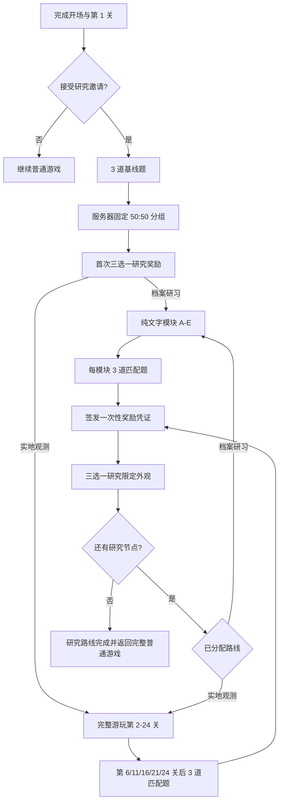

# Pixel Observatory 游戏内研究与问卷奖励设计

日期：2026-08-08

状态：设计已获用户原则批准，等待规格复核

范围：研究路线、游戏内问卷、匿名数据、游客参与、社区外观奖励和管理端统计

## 1. 目标

本功能要解决两个彼此关联的问题：

1. 让论文获得可分析的学习数据，比较纯文字学习与完整游戏操作对天文概念理解的影响。
2. 把问卷从独立、冗长的网页任务，改造成玩家愿意主动完成的短事件，并给予只影响社区外观的高价值奖励。

问卷不能阻断主线，也不能用正确率决定奖励。研究数据必须匿名，账号系统只保存奖励领取证明，不能保存玩家的具体答案。

## 2. 研究问题

主要研究问题：

- 阅读等量的纯文字知识卡后，玩家对望远镜与观测概念的掌握程度如何？
- 完成对应的游戏关卡后，玩家对相同概念的掌握程度如何？
- 两条路线在答题正确率、完成时间、放弃率和延迟作答率上有何差异？

次要观察指标：

- 哪些概念最容易因实际操作而改善，例如调焦、倍率、视场、寻星和大气条件？
- 哪些题目在两种路线中都困难，可能说明教学材料或题目本身需要修改？
- 外观奖励是否能提高短问卷的完成率，但又不诱导玩家随意作答？

本功能不直接宣称游戏具有教育效果。正式结论仍需经过合适的参与者招募、同意流程、样本量说明和统计分析。

## 3. 核心研究设计

### 3.1 固定 50:50 分组

每名参与者在研究开始时被随机分配到一条路线，并在整个研究周期内保持不变：

- `archive_text`：档案研习路线，只阅读纯文字知识卡并完成问卷。
- `field_gameplay`：实地观测路线，完整游玩原有关卡并在阶段节点完成问卷。

界面对玩家使用“档案研习”和“实地观测”两个中性名称，不出现“对照组”“实验组”或暗示优劣的词语。

分组在服务器端以隐藏顺序的随机区组完成，并让两组有效样本数保持近似 50:50。分组结果与研究版本绑定，刷新页面、游客转注册账号或通过匿名续研凭证更换设备后不得重新抽组。

界面可以用一次简短的“研究路线抽取”动画表现分组，但动画只负责情绪反馈，不能让玩家自行选择或重抽。

### 3.2 共同起点

所有参与者都保留游戏开场剧情和第 1 关，用于建立相同的角色、操作和研究背景。第 1 关完成后，在安全节点弹出可跳过的研究邀请。

接受后先完成 3 道低门槛基线题：

- 题目允许选择“我不确定”。
- 不显示分数，不要求答对才能继续。
- 基线题前不展示对应知识卡，避免提前教学污染基线。
- 基线完成后才进行路线抽取。
- 基线完成同样发放一次三选一研究奖励，让首次参与立即获得正反馈。

拒绝邀请不会影响主线、社区等级或普通奖励。

### 3.3 档案研习路线

档案路线进入独立的 Observatory Archive 界面。它只提供排版清晰的纯文字材料、静态标题和必要术语，不包含可操作望远镜、动态光学模拟、实时天体图像或游戏式提示。

研究期间依次开放五个短模块：

| 模块 | 对应游戏内容 | 核心概念 |
| --- | --- | --- |
| A | 第 2 至 6 关 | 北极星定位、光路、调焦、倍率与视场、寻星镜校准 |
| B | 第 7 至 11 关 | 口径、集光能力、深空目标、过高倍率、低空观测 |
| C | 第 12 至 16 关 | 月面细节、倍率复习、坐标、寻星对齐、窄视场问题 |
| D | 第 17 至 21 关 | 逐级寻星、暗弱目标、口径限制、坏天气与暗空地点 |
| E | 第 22 至 24 关 | 地球自转、追踪、色差和长时间观测 |

每个模块阅读完成后出现 3 道题。参与者可中途退出并从当前模块继续。

档案路线的研究入口内不开放第 2 至 24 关的对应游戏内容。普通游戏入口仍然可用，玩家也可以随时退出研究。若参与者在研究完成前从其他入口进入普通游戏，系统不强制阻止，但会将后续研究记录标记为 `cross_exposed`，从主要组间分析中排除，并保留在探索性分析中。完成全部研究模块后，界面直接提供返回完整普通游戏的入口。

### 3.4 实地观测路线

实地观测路线完整保留原游戏流程、开场动画、组装、寻星、调焦、观测结果和关卡之间的剧情，不删减必要步骤。

问卷只在返回大厅、任务结算完成或下一个任务尚未开始的安全节点出现：

| 节点 | 触发时机 | 覆盖内容 |
| --- | --- | --- |
| A | 第 6 关完成后 | 第 2 至 6 关 |
| B | 第 11 关完成后 | 第 7 至 11 关 |
| C | 第 16 关完成后 | 第 12 至 16 关 |
| D | 第 21 关完成后 | 第 17 至 21 关 |
| E | 第 24 关完成后 | 第 22 至 24 关及综合回顾 |

问卷不得在观测、组装、对话或动画进行中抢占输入。游戏路线在答题前不能显示档案路线的对应文字材料，以免两种干预混合。

## 4. 问卷体验

### 4.1 长度与节奏

- 每次 3 道题，目标完成时间 45 至 60 秒。
- 一屏只展示一道题，提交后使用短促的横向过渡进入下一题。
- 不在研究问卷中显示即时对错，避免后续题受到提示影响。
- 完成后才显示感谢与奖励，不显示带有羞辱感的低分评价。
- 正确率不影响外观、研究等级或抽取稀有度。

### 4.2 跳过规则

每次问卷都提供“稍后填写”。连续两次选择稍后后，再提供“本次会话不再提醒”。

跳过后的问卷会保留在“研究记录”入口中。若玩家在完成后续教学内容后才补答，记录标记为 `late_response`，不进入主要即时学习效果分析。

玩家可在设置中重新开启本次会话提醒。跳过不会扣分、降级或失去普通游戏内容。

### 4.3 题库与答案位置

每个节点至少准备三套等价题型，每套 3 题。每道题都必须记录：

- `concept_id`
- `module_id`
- `form_id`
- `difficulty`
- `language`
- `question_version`
- 正确答案和干扰项依据

同一参与者在同一节点只收到一套固定题型。选项顺序使用参与者与题目共同生成的稳定随机种子打乱，正确答案不得总在 A。中英文版本必须表达同一概念、具有相同正确答案，并由人工复核，而不是运行时机器翻译。

两条路线在同一节点使用同一题库规则，以便比较。不同题型之间需要保持概念覆盖和难度近似。

## 5. 奖励设计

### 5.1 奖励原则

- 奖励只改变社区头像、个人主页和聊天外观。
- 奖励不能提高望远镜性能、关卡分数、Credits 或排行榜优势。
- 每完成一份问卷即可获得奖励，不看正确率。
- 游客可以立即装备奖励；注册或登录后可将奖励永久合并到账号。
- 同一研究节点只能领取一次奖励。

### 5.2 十二套研究限定外观

每套包含头像、头像框、个人主页背景、名字辉光、聊天气泡、徽章和称号七个组件。

| ID | 名称 | 视觉主题 | 称号 |
| --- | --- | --- | --- |
| R01 | Solar Crown 日冕王冠 | 金白日珥与细密光针 | 日冕记录者 |
| R02 | Lunar Archive 月面档案 | 银蓝月纹与黄铜刻度 | 月海制图师 |
| R03 | Nebula Weaver 星云织者 | 青、洋红与黑色尘埃层 | 星云织者 |
| R04 | Aurora Navigator 极光领航 | 绿色极光帘与冰蓝边光 | 极夜领航员 |
| R05 | Pulsar Herald 脉冲使者 | 射电波束与周期光环 | 脉冲报时者 |
| R06 | Event Horizon 事件视界 | 黑金吸积环与引力透镜 | 视界守望者 |
| R07 | Deep Sky Cartographer 深空制图 | 星图网格与坐标刻线 | 深空制图师 |
| R08 | Infrared Alchemist 红外炼金 | 多波段假彩色与棱镜边缘 | 红外炼金师 |
| R09 | Radio Sentinel 射电哨兵 | FAST 馈源舱、频谱与翡翠信号 | 天籁哨兵 |
| R10 | Mirror Master 镜面大师 | 六边镜片、准直十字与银光 | 波前校准师 |
| R11 | Sidereal Voyager 恒星时旅者 | 子午环、钟面与深蓝星轨 | 恒星时旅者 |
| R12 | Observatory Laureate 天文台桂冠 | 金色穹顶、桂冠与群星徽记 | 天文台桂冠 |

视觉素材采用固定官方资源，不允许玩家上传头像。资产需要单独导出，不使用程序临时绘制的简单几何图代替最终美术。

### 5.3 三选一抽取

问卷完成后，服务器从尚未拥有的套装中返回 3 套候选，玩家选择 1 套：

1. 星图台点亮，显示“研究记录已封存”。
2. 三个密封星匣依次进入画面，外观只显示主题线索。
3. 玩家选择后，所选星匣展开为完整套装。
4. 头像、边框、背景、称号和徽章分层装配到预览角色。
5. 研究威望提升一级，并给出“立即装备”和“稍后查看”。

完整动画控制在 6 至 8 秒，可点击加速但不能误跳过奖励入账。支持 `prefers-reduced-motion`，减少位移和闪光但保留明确的获得反馈。

当前研究包含 1 次基线奖励和 5 次节点奖励，最多产生 6 次奖励，因此 12 套库存足以保证每次都能提供 3 个未拥有候选。未来增加问卷节点时必须同时扩充奖池，不能静默改为重复奖励。

### 5.4 研究威望

每完成一份问卷，研究威望提升一级。它与按游玩时长计算的社区段位分开，只表示参与研究的历程。

研究威望不进入竞技排行榜。个人主页可展示完成节点数、已获得的研究徽章和当前研究称号，但不公开答案、分数或分组。

## 6. 游客与账号迁移

游客首次接受研究时生成本地 `participant_id` 和匿名研究密钥。游客可以完成问卷、抽取奖励和立即装备。

游客注册或登录时：

1. 客户端提交尚未兑换的签名奖励凭证。
2. 账号服务验证签名、节点、研究版本和防重放随机数。
3. 奖励与研究威望合并到账号一次。
4. 本地凭证标记为已迁移，重复提交不再发奖。

账号服务只接收奖励凭证和不可读的匿名续研凭证，不接收答案、正确率或可查询的研究分组字段。匿名续研凭证由研究服务签名并加密，账号服务只能原样保存，不能读取其中的参与者标识和路线。游客清除浏览器数据前若未注册，未同步奖励可能丢失，界面需要明确提示但不能强迫注册。

## 7. 数据与隐私

### 7.1 数据分离

研究数据库保存：

- 匿名参与者标识
- 研究版本与固定路线
- 问题版本与选项顺序
- 作答、耗时、跳过、延迟和完成时间
- 游戏节点或文字模块的实际暴露时间
- `cross_exposed`、`late_response` 等分析标记

账号数据库保存：

- 已兑换的研究节点
- 已拥有的外观套装
- 当前装备
- 研究威望等级

两个数据库之间不保存明文账号到答案的映射。研究服务只向账号服务签发一次性奖励凭证和不可读的匿名续研凭证。研究导出在生成时移除续研凭证、网络地址和设备信息，只保留随机研究编号。运维权限必须分离，避免管理员从两个后台拼接个人身份与答案。

### 7.2 同意与撤回

研究邀请必须说明：

- 参与自愿，可跳过或退出。
- 不参与不会影响完整游戏体验。
- 答案用于学术研究和改进游戏。
- 数据以匿名形式保存。
- 奖励按完成发放，与正确率无关。

界面提供“撤回本次研究记录”。撤回后研究答案不可继续用于新分析；已经兑换的外观奖励不回收，避免用奖励惩罚撤回。

若研究对象可能包含未成年人，正式招募前需由研究负责人确认学校或机构要求的同意程序。本设计不替代伦理审查。

## 8. 系统架构

### 8.1 组件

- Godot 游戏：发出关卡完成、安全弹窗节点、语言、活动时长和游戏路线暴露事件。
- 网站游戏壳：显示研究邀请、问卷、文字档案、奖励动画和游客同步状态。
- Research API：固定分组、题目分配、匿名答案、完成状态、一次性奖励凭证和管理统计。
- Account API：登录、游客合并、外观库存、装备状态和研究威望。
- 管理后台：匿名聚合、题库版本、导出与异常监控。

Godot 与网站壳通过明确版本的桥接事件通信，不直接访问数据库。

### 8.2 主要事件

```text
study.invite_ready
study.baseline_completed
study.assignment_received
study.safe_checkpoint
study.module_exposure_started
study.module_exposure_completed
study.questionnaire_deferred
study.questionnaire_completed
study.reward_receipt_issued
study.reward_redeemed
study.route_completed
```

每个事件包含 `study_version`、`participant_id`、`event_id` 和时间戳。服务器按 `event_id` 幂等处理，页面重载或网络重试不能重复提交答案或发奖。

### 8.3 状态流程



## 9. 失败与边界处理

- 网络中断：答案先保存在加密的本地待提交队列，恢复后按 `event_id` 重试。
- 提交成功但奖励页关闭：奖励凭证保留，下一次进入时直接恢复三选一，不重新答题。
- 奖励已选但动画中断：服务器库存已经入账，重进后显示简化获得确认。
- 游客换设备：未注册游客无法跨设备恢复，需在抽奖后清楚提示。
- 语言切换：保持当前题号、已选答案和计时，不重新抽题。
- 版本更新：已经开始的参与者锁定原题库版本，不能在同一路线中混用新旧题目。
- 重复节点事件：服务端返回已有状态，不重复记录曝光或发奖。
- 不活跃页面：页面隐藏或游戏失焦时暂停有效学习时长，避免把挂机时间计入暴露时间。

## 10. 管理后台

管理员可查看匿名聚合数据：

- 两组有效样本数与分组平衡
- 各节点邀请、接受、完成、跳过和退出率
- 正确率、活动作答时长和材料暴露时长
- 题目难度、选项分布和中英文版本差异
- `late_response` 与 `cross_exposed` 数量
- 奖励候选、选择率和兑换失败率

管理员可以导出匿名 CSV。导出不得包含用户名、邮箱、聊天记录、IP 地址或可用于识别个人的原始设备信息。

题目、翻译和研究说明采用版本化发布。修改已上线题目时创建新版本，不覆盖历史答案对应的原文。

## 11. 验收标准

### 11.1 研究流程

- 同一参与者刷新、重登和游客合并后仍保持同一路线。
- 两组都完成相同概念覆盖的五个节点与基线题。
- 档案路线研究界面不包含对应可玩模拟。
- 游戏路线完整保留第 1 至 24 关的开场、组装、观测和剧情步骤。
- 问卷只在安全节点出现，不抢占游戏输入。
- 延迟补答和跨路线暴露被正确标记。

### 11.2 问卷与语言

- 每次恰好 3 题，选项顺序稳定随机且正确答案位置分布不固定。
- 中英文切换保持题目进度，两个版本含义一致。
- 跳过、会话静默和设置恢复提醒均可用。
- 正确率不影响发奖。

### 11.3 奖励

- 每个节点只签发和兑换一次。
- 每次展示 3 个未拥有套装且选择后不重复。
- 游客可装备，注册后只合并一次。
- 12 套外观的七个组件都能在个人主页、社区和聊天中正确显示。
- 奖励动画在桌面、1024x768 和手机视口无溢出，减少动态模式可用。

### 11.4 数据与安全

- 研究答案与账号库存分库，账号后台无法查看单个玩家答案。
- 研究数据库不持久化 IP 地址、邮箱、用户名或原始设备指纹。
- API 具备幂等、防重放、速率限制和输入校验。
- 页面隐藏时不累计有效学习时长。
- 匿名 CSV 不包含身份字段。
- 撤回记录后不再进入新的研究分析，既得外观不被删除。

## 12. 非目标

本阶段不包括：

- 用 AI 自动生成或自动评分研究题目。
- 根据正确率改变奖励稀有度。
- 玩家上传头像或自定义图片。
- 研究威望影响望远镜性能、Credits 或社区竞技排名。
- 对教育效果做未经验证的因果结论。
- 在 FAST、太空红外望远镜等第 24 关后的高级内容中继续增加研究节点。

## 13. 实施顺序建议

1. 建立研究状态机、固定分组和数据分离契约。
2. 完成基线、五个匹配题库节点及中英文版本。
3. 接入 Godot 安全节点和两条路线的暴露时间。
4. 完成游客凭证、账号合并和防重复发奖。
5. 制作 12 套正式外观资产与三选一动画。
6. 建立管理端聚合、匿名导出和撤回流程。
7. 完成自动测试、真实浏览器测试和小规模试运行后再正式招募。
